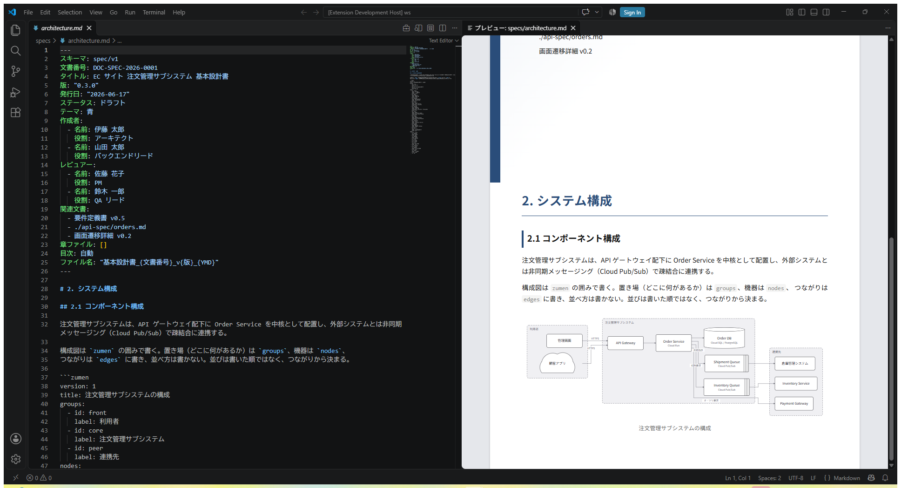
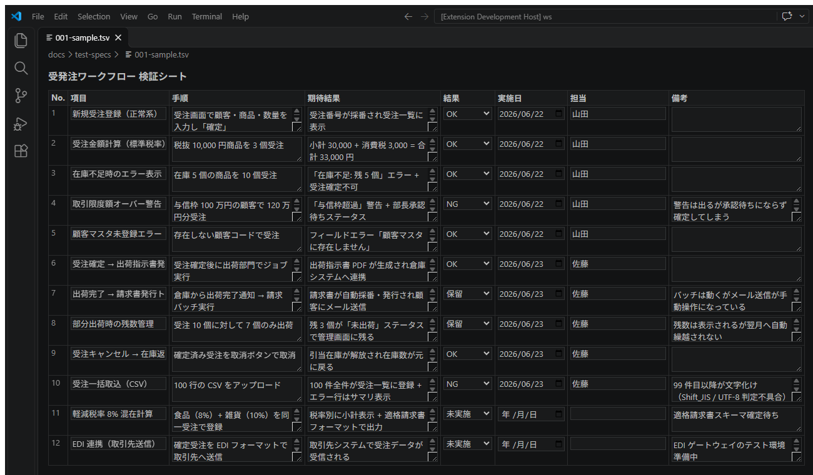
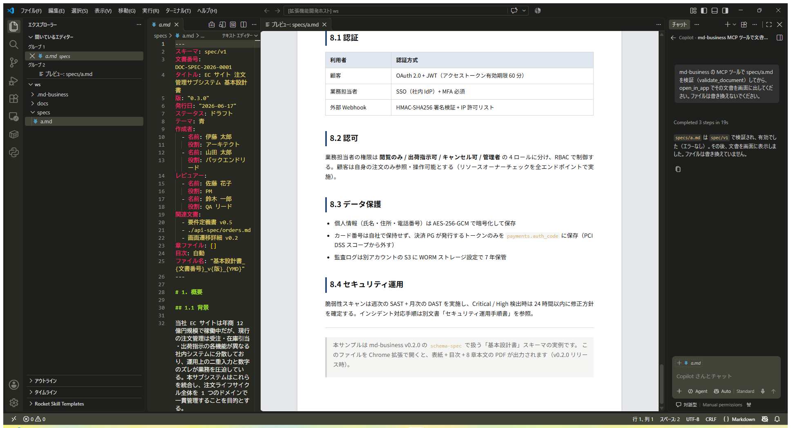

# md-business for VS Code

Markdown-first business documents in VS Code: invoices, basic design specs, test specs, DB specs, API specs and investigation reports written as Markdown frontmatter + JSON Schema, plus test-spec sheets in TSV.

**The problem it solves:** specs and invoices usually live in Word or Excel, where an AI agent can read them but cannot safely edit, validate or diff them. Here the document is a plain Markdown file in your repository. The agent edits it, the schema catches what it got wrong, Git keeps the history, and people read it as a printed document or a table.

## What it does

1. **Schema errors in the Problems panel.** Documents that declare a schema (`schema: invoice/v1`, `schema: spec/v1`, …) are validated as you type and on save, and each error points at its line. Test-spec TSV files (first line `#! md-business:test-spec-tsv/v1`) are checked too: the header line, column definitions, required cells and values outside the allowed choices. Markdown files without a schema declaration are left alone.
2. **See the document the way it is used.**
   - **md-business: 業務文書としてプレビュー** (the briefcase button at the top right of the editor) opens the document as it will be printed, beside the source. Code blocks are drawn as well:
     - `zumen` — an architecture diagram written in the document itself.
     - `chart` — a bar, line or pie chart from a TSV file next to the document (`source: data/sales.tsv`).
     - `data` — a TSV file next to the document, quoted as a table.

     A block that cannot be drawn stays in place with the reason above it (a missing file, an unknown chart type, a column that is not there).

     

   - **表で開く** (the table button) opens a `.tsv` test-spec sheet as a grid. The text stays the source of truth: each cell you change is written back to that row only, so undo, save and diffs work as usual.

     

3. **The md-business MCP tools for agent mode.** The MCP server ships inside the extension and is registered for each workspace folder, running on VS Code's own Node: nothing else to install. In Copilot Chat agent mode you can ask it to validate, read, create or update documents and test-spec rows. `open_in_app` opens the document inside VS Code (Markdown with its preview, TSV in the grid editor).

   

Not in this version: PDF export, adding / removing / reordering rows in the grid.

## Try it

Install **md-business** from the Marketplace, open a Markdown file that starts with `schema: spec/v1` frontmatter, and press the briefcase button. Templates for every document type are in [`templates/`](https://github.com/meta-taro/md-business/tree/main/templates).

From this repository:

```bash
pnpm install
pnpm --filter md-business-vscode test:run
pnpm --filter md-business-vscode package   # writes md-business-vscode-<version>.vsix
```

## Links

- Source and issues: [github.com/meta-taro/md-business](https://github.com/meta-taro/md-business)
- Website and user guide: [meta-taro.github.io/md-business](https://meta-taro.github.io/md-business/)
- Desktop app (Windows / macOS, with PDF export): [download](https://meta-taro.github.io/md-business/download/)
- Chrome extension (read and print in the browser): [Chrome Web Store](https://chromewebstore.google.com/detail/lmdplkkfmgapnhombimeohjliinifgjh)
- Diagrams in `zumen` code blocks are drawn by [zumen](https://github.com/meta-taro/zumen) ([VS Code extension](https://marketplace.visualstudio.com/items?itemName=meta-taro.zumen-vscode))

## License

MIT
