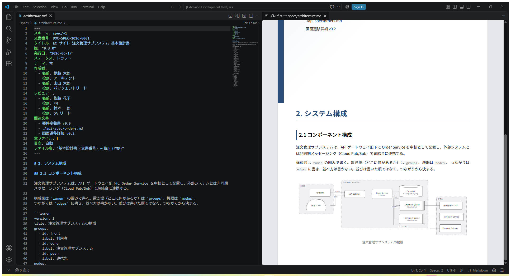
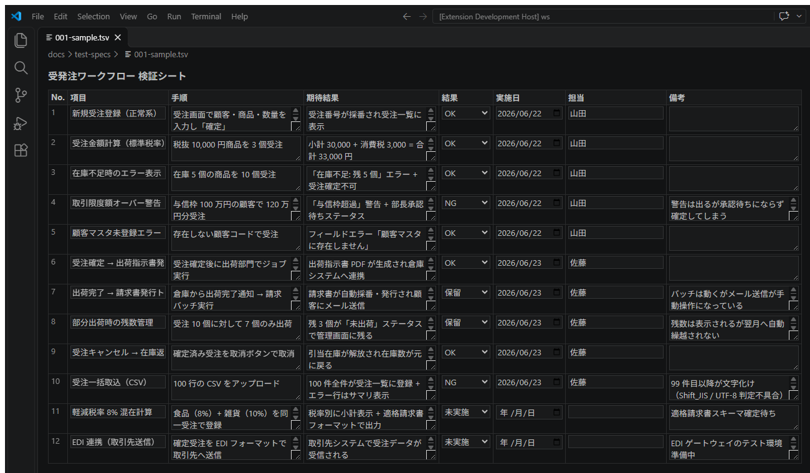
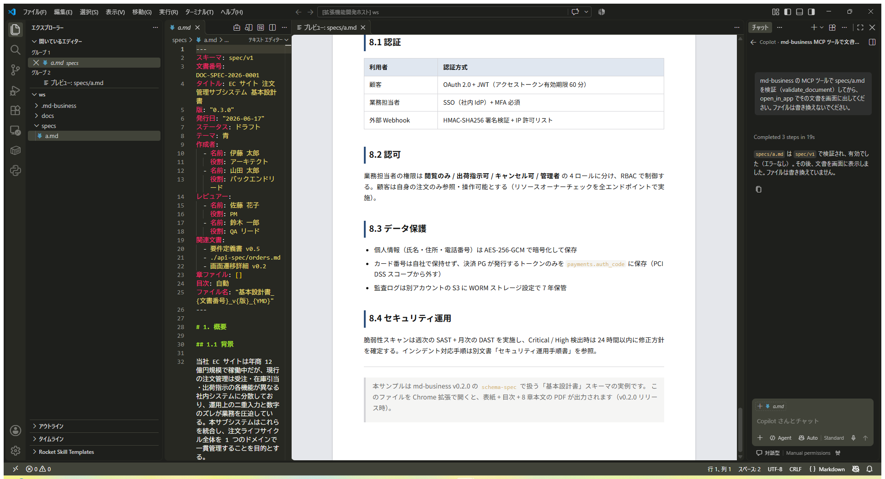

# md-business for VS Code

Markdown-first business documents in VS Code — invoices, basic design specs, test specs, DB specs and API specs written as Markdown frontmatter + JSON Schema, plus test-spec sheets in TSV.

## Features

### Schema errors in the Problems panel

Documents that declare a schema (`schema: invoice/v1`, `schema: spec/v1`, …) are validated as you type and on save. Errors appear in the Problems panel with the line they belong to. Test-spec TSV files (first line `#! md-business:test-spec-tsv/v1`) are checked too: the header line, column definitions, required cells and values outside the allowed choices.

Markdown files without a schema declaration are left alone.

### Business-document preview

Run **md-business: 業務文書としてプレビュー** (the briefcase button at the top right of the editor) to open the document as it will be printed, beside the source. Architecture diagrams written as `zumen` code blocks are drawn as diagrams.



### Edit test-spec TSV as a table

Run **表で開く** (the table button) on a `.tsv` test-spec sheet to edit it as a grid. The text stays the source of truth: each cell you change is written back to that row only, so undo, save and diffs work as usual.



### MCP tools for agent mode

The extension registers the bundled md-business MCP server for each workspace folder, running on VS Code's own Node — nothing else to install. In Copilot Chat agent mode you can ask it to validate, read, create or update documents and test-spec rows. `open_in_app` opens the document inside VS Code (Markdown with its preview, TSV in the grid editor).



Not in this version: PDF export, adding / removing / reordering rows in the grid.

## Development

```bash
pnpm --filter md-business-vscode test:run
pnpm --filter md-business-vscode package   # builds md-business-<version>.vsix
```

## License

MIT
